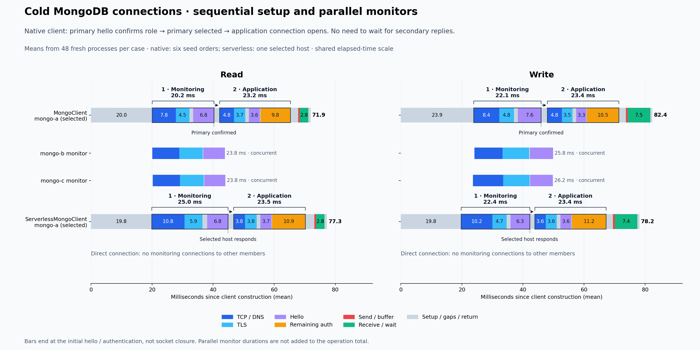

# Mini Benchmark Results

MongoDB driver discovery compared with direct connections through the serverless driver, locally and on AWS Lambda.

For documentation on the benchmark, see [README.md](benchmark/README.md).

## Execution

```sh
npm run benchmark -- --no-monitoring --samples 48 --output benchmark/results/run.json
npm run benchmark:test
```

The run includes a monitoring-enabled serverless control. The comparison below
uses the MongoDB driver and the serverless driver with monitoring disabled.

## Connection selection and timings



The read panels show measured examples where the **first identified secondary**
was selected and the same application connection served the read. This happened
in 31/48 local reads and 10/30 AWS reads. The illustrated read sample is nearest
the median within that subset; the other traces are nearest their cohort medians.
Braces point to the selected member. Writes select the primary.

The table and diagram headings report means across **all samples**, including
reads that opened a second application connection. The end labels on the bars
are the durations of the individual illustrated samples.

| Environment / operation | MongoDB driver | Serverless driver | Reduction |
| --- | ---: | ---: | ---: |
| Local read | 48.2 ms | 34.9 ms | 27.6% |
| Local write | 54.0 ms | 47.5 ms | 11.9% |
| AWS read | 290.3 ms | 204.7 ms | 29.5% |
| AWS write | 261.7 ms | 218.4 ms | 16.5% |

Percentages use unrounded means. There were 48 fresh local processes and 30
verified cold Lambda invocations per driver/operation, with no failures. Timing
starts at client construction and ends at the operation result; imports, Lambda
INIT, watcher work and client close are excluded. AWS uses the default 1024 MB
allocation.

The MongoDB driver receives the cluster SRV URI and uses `secondaryPreferred`
for reads and default primary selection for writes. Its three monitors overlap;
a write waits for the primary to identify itself, not for all three responses.
`secondaryPreferred` may fall back to a primary if no secondary is known.
All reads in this cohort reached secondaries; all writes reached primaries.

`connect()` and `findOne()` select independently. In 17/48 local reads and 20/30
AWS reads, one invocation authenticated to a member during `connect()`, then
opened another application connection to a different member for `findOne()`.
Only the latter served the read. These are real additional connections within
one process, not traces combined from different invocations. The simplified
read diagram shows the single-application-connection case, not every possible
selection sequence.

The serverless driver receives watcher-provided secondary/read and primary/write
member URIs with `directConnection=true`. Every serverless sample used exactly
one authenticated application socket and no monitoring socket. Watcher selection
happens outside the timed invocation.

## Local environment

The local harness now uses SRV/TXT DNS, SCRAM-SHA-1, indexed reads and
majority-acknowledged updates, matching the AWS workload. The client has 1 GiB
memory and a 0.579 CPU quota. The read secondary shares its simulated zone and
has the shortest injected network path. Default added RTTs remain 0.5 ms within
a zone and 2 ms between zones; Docker scheduling adds to those delays.

The earlier local configuration read from the primary, used explicit seed
addresses, unrestricted CPU, SCRAM-SHA-256 and inserts, and placed the primary
on the shortest path. These differences made the previous local and AWS runs
poor comparisons. Docker still differs in CPU speed, scheduling, DNS, TLS and
database deployment; its timings are not predictions of AWS latency.

See the [harness usage and limitations](benchmark/README.md) and the
[PR comparison](https://github.com/alexbevi/mongodb-serverless/pull/2#issuecomment-6196282564).

## Historical results

The older [local samples](benchmark/baseline/samples.json) and
[AWS samples](benchmark/aws/samples.json) retain their original configurations
and do not underlie the current diagram. The older `benchmark/report.py` renderer
assumes one application connection and is intended for those historical datasets.
