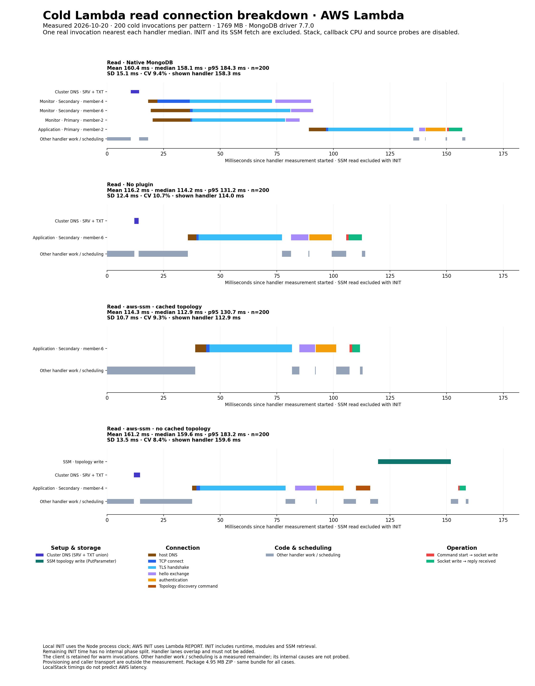

# MongoDB Serverless Driver

A wrapper around the [MongoDB Node.js driver](https://github.com/mongodb/node-mongodb-native)
that discovers replica-set members and routes operations directly to them.
An optional plugin shares topology across client instances.

The driver discovers topology on first use through one direct member connection,
retains that connection for operations, and opens another only when the required
role differs. With a plugin, later cold starts can reuse cached topology.
Topology-related write failures trigger a refresh and one bounded retry when the
server confirms that the write was rejected before execution. No separate
watcher process is needed.

Reads prefer a healthy secondary; writes go to the primary.

## Benchmark


See the [Lambda benchmark](benchmark/LAMBDA.md), [recorded AWS results](benchmark/results/aws/results.md), [benchmark usage](benchmark/README.md) and the recorded [benchmark](BENCHMARK.md) for full details.

## Components

| Directory | Package | What it does |
|---|---|---|
| `driver/` | `@mongodb-serverless/driver` | Replaces `MongoClient` and routes operations to a read or write client |
| `plugins/shared/` | not published | The plugin contract, compiled into each plugin |
| `plugins/local/` | `@mongodb-serverless/plugin-local` | Reads topology from an environment variable |
| `plugins/aws-ssm/` | `@mongodb-serverless/plugin-aws-ssm` | Fetches a SecureString URI and cached topology in one SSM request |

## Quickstart

Change the import and supply a replica-set connection string.

```ts
import { MongoClient } from '@mongodb-serverless/driver';

const client = new MongoClient(uri);

await client.db('app').collection('users').insertOne({ n: 1 }); // primary
await client.db('app').collection('users').find({}).toArray();  // secondary
```

Every other export (`ObjectId`, `ReadPreference`, the error classes) passes
through to the real driver unchanged.

With `disableMonitoring: true` and a pool limit of one, healthy bootstrap opens
one socket when the chosen member can serve the operation, or two when another
member is needed. See [the bootstrap diagrams and configuration](docs/bootstrap.md)
for the supported authentication modes and connection-count limits.

The optional local plugin stores discovered topology in the current process
environment.
For shared topology across Lambda instances, use the [SSM plugin](plugins/aws-ssm),
which fetches the connection string and topology together. See [the architecture and plugin sequences](docs/architecture.md).

## Scope

v1 supports replica sets only. Sharded and load-balanced clusters report
topology through commands other than `replSetGetStatus`, so they need a
different source. Change streams and sessions that span the read and write
client are also unsupported. See `driver/README.md` for the details and the
reasoning.

Discovery needs `replSetGetStatus` permission. Network failures, bulk operations,
and cursors can leave partial or unknown outcomes, so these refresh topology
without automatic replay. Read failures do not trigger refresh. See the
[driver limitations](driver/README.md) before migrating.

## Development

```sh
pnpm install
pnpm test              # everything, including the real cluster
pnpm test:unit         # no Docker, no build, for a fast loop
pnpm test:integration  # just the cluster suite
pnpm typecheck
```

The integration suite runs against a real 3-node replica set that
`test/harness/cluster.ts` starts in Docker on demand and reuses across
runs. Without Docker it skips. `pnpm cluster:stop` removes the container; the
next run rebuilds it in about 30 seconds.

Requires Node 20.19 or later. See `AGENTS.md` for the working agreement.

## Releasing

See the [release guide](.github/RELEASING.md) for versioning, publishing, and
new package setup.
