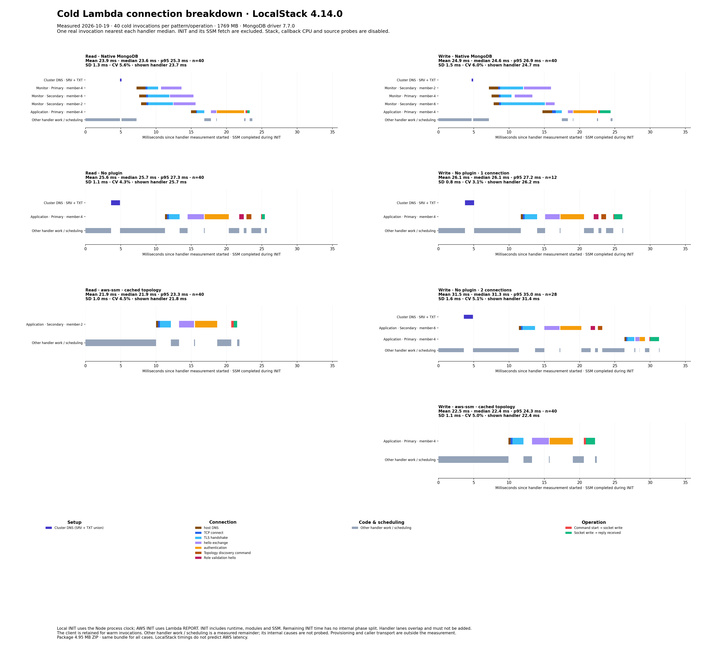

# Cold connection benchmark

Compare MongoDB driver discovery with a serverless driver that connects directly
to a watcher-selected replica-set member. Each sample creates a fresh Node process,
constructs a client, and completes its first operation against a three-member
TLS replica set. The operation connects automatically; the benchmark does not
call `client.connect()` first.

The [local results](../BENCHMARK.md) retain 600 cold invocations: 100 per
read/write and driver variant, including the monitoring-enabled control, collected
in four batches of 25.
Code probes and callback tracing measure the breakdown below. There is no
container CPU quota. Timings and percentage reductions include profiling overhead.

### Reading the diagram



The bars, percentage headings and summary use the same measured cohort.
Headers compare cohort medians; the percentage is `100 × (1 − serverless median / native median)`.
Following [Google Benchmark](https://google.github.io/benchmark/user_guide.html),
the same header line also shows mean, sample standard deviation (SD) and coefficient
of variation (CV = SD / mean). The summary retains p95, median absolute deviation
(MAD) and uncertainty for the mean reduction. These intervals use 2,000 hierarchical paired
bootstrap resamples: batches first, then iterations within each batch. AWS uses
paired five-worker rounds within each batch. Batch ranges show the observed
variation in mean reduction. The intervals describe uncertainty within these
recorded runs, not performance across other deployments.

Elapsed benchmark time covers the full collection process, including setup/reset
and teardown. The saved `runTiming` records its scope and clock precision.
Repeated execution stacks are stored in `executionSources`; segment `sourceId`
values refer to that list without discarding any measurements.

Timing runs from [handler invocation to its return](handler-base.ts#L98).
The headings above the bars describe elapsed sections:

- **Setup** runs from handler invocation to the first socket creation.
- **Monitor Connection** runs from that monitor socket's creation through its
  last recorded handshake phase. Monitors discover member roles and overlap
  across nodes; their durations must not be added.
- **Application Connection** runs from socket creation to the matched
  `connectionReady` event for the socket serving the operation. It includes
  hostname resolution, handshakes, authentication and readiness processing.
- **Operation** runs from that readiness event to handler return. It includes
  checkout/dispatch, the command exchange and completion processing, not just
  database execution.

These boundaries are defined in [section_spans](report.py#L427), using
[connection and command event matching](metrics.ts#L57). Braces show the transition
from replica-set discovery to the selected application connection. The direct
client skips replica-set monitoring. `~` denotes rounded milliseconds.

The definitions below cover the diagnostic legend. Collect those additional
measurements with `--diagnostics`; ordinary runs retain socket and lifecycle
measurements but do not record the code scopes or callback CPU counters.
[Source probes](source-probes.ts#L3) modify only the Docker copies of the built
packages. The [activity recorder](activities.ts) measures their boundaries;
[display grouping](report.py#L165) merges adjacent related spans without absorbing
intervening waits. Detailed spans remain in the raw JSON. The legend follows first
appearance within each stage; parallel work can make the order differ across traces.

### Setup legend

**Callback execution.** Main-thread execution between Node's async-hook `before`
and `after` boundaries, including promise continuations. The initial synchronous
handler call is recorded explicitly. This colour fills time outside more specific
measured phases. A callback's elapsed duration can include a pause while the thread
is off CPU. The [execution recorder](execution.ts#L27) retains wall time, thread CPU,
resource type and the resource's creation stack. That stack identifies where the
async work was scheduled; it is not a sampled stack of every instruction executed.
This colour has the same meaning in all three legends.

The parenthesized names list the three largest identified work categories in each
stage from a separate local CPU profile: 20 cold invocations per driver/operation,
80 analyzed invocations across the native and no-monitoring clients. They describe
sampled work, not every callback or exact shares of the illustrated bars. Unclassified
stacks remain in the retained evidence; the legend ranks named categories only.
The performance statistics still use the original 100 iterations per cohort.

- **IP validation:** `isIPv4` / `isIPv6`, called from the driver's
  [TLS option parsing](https://github.com/mongodb/node-mongodb-native/blob/v7.7.0/src/cmap/connect.ts).
- **Server creation:** construction of the driver's
  [Server objects](https://github.com/mongodb/node-mongodb-native/blob/v7.7.0/src/sdam/server.ts).
- **SCRAM preparation:** nonce generation, including lazy loading of Node crypto
  helpers, beneath [SCRAM's prepare method](https://github.com/mongodb/node-mongodb-native/blob/v7.7.0/src/cmap/auth/scram.ts).
- **Connection creation / handshake setup:** the
  [Connection constructor](https://github.com/mongodb/node-mongodb-native/blob/v7.7.0/src/cmap/connection.ts)
  and [performInitialHandshake](https://github.com/mongodb/node-mongodb-native/blob/v7.7.0/src/cmap/connect.ts),
  outside separately timed wire phases.
- **Command handling / operation execution:** continuations in
  [Server.command](https://github.com/mongodb/node-mongodb-native/blob/v7.7.0/src/sdam/server.ts)
  and [executeOperation](https://github.com/mongodb/node-mongodb-native/blob/v7.7.0/src/operations/execute_operation.ts).
- **Tracing overhead:** the benchmark's own [async-hook recorder](execution.ts),
  particularly creation-stack capture and formatting. This cost belongs to the
  diagnostic instrumentation, not normal driver operation.

The sampled stacks and counts are stored in `callbackProfile` in the local
`samples.json`. The [classifier](report.py) gives tracing overhead priority over
its caller and groups the remaining named functions by their work. AWS has no
corresponding CPU profile; these local labels are not applied to AWS.

**Client & topology initialization.** Related scopes for creating the wrapper and
native client, parsing URI/options, reading the plugin's topology, rewriting a
direct member URI and constructing the native topology. See the
[benchmark client factory](handler-base.ts#L78), [member/client resolution](../driver/src/clients.ts#L66),
[direct URI rewrite](../driver/src/uri.ts#L18), and the native driver's
[constructor](https://github.com/mongodb/node-mongodb-native/blob/v7.7.0/src/mongo_client.ts#L444)
and [connection setup](https://github.com/mongodb/node-mongodb-native/blob/v7.7.0/src/mongo_client.ts#L623).
Plugin reads are asynchronous; construction and parsing scopes are synchronous.
Separate occurrences share a colour but are joined only when adjacent.

**Event-loop wait / dispatch.** The measured interval after one callback exits and
before the next callback enters. It can include waiting for I/O, event-loop work,
native runtime work and scheduling delays. The [recorder's transitions](execution.ts#L27)
associate it with the next resource's type and creation stack. It is not a claim
that the thread slept throughout, or that the next resource caused the whole delay.
This definition also applies in Connection and Operation.

**Runtime & handshake metadata.** The native driver's wait for its runtime adapter
and its container-metadata probe, grouped under one colour. This supports the
[client metadata sent in the handshake](https://github.com/mongodb/node-mongodb-native/blob/v7.7.0/src/cmap/handshake/client_metadata.ts#L108).
The [probes](source-probes.ts#L13) wrap those specific promises; other metadata
assembly between them remains in the measured callback intervals. Overlapping
async scopes are not added together.

**Read TLS CA certificate.** The asynchronous read of the configured CA certificate
file before connecting. It includes filesystem/cache service and the delay until
the promise continuation runs. See the [certificate-read probe](source-probes.ts#L10)
and the native client's [TLS file loading](https://github.com/mongodb/node-mongodb-native/blob/v7.7.0/src/mongo_client.ts#L623).
This is distinct from the later TLS handshake.

**Cluster DNS.** SRV and TXT queries for the `mongodb+srv` seed list and connection
options. The shared block spans all node lanes because discovery precedes the
individual sockets. Queries may overlap; the block covers first query start to
last completion, while accounting counts their union. The
[DNS instrumentation](instrument.ts#L51) records the individual requests.
Direct member URIs skip these queries but still perform Host DNS.

**No-monitoring initialization.** Loading the wrapper's no-monitoring module and
activating its patch. Module loading can include file access, evaluation and promise
dispatch; activation validates and installs the patch. See the
[lazy import and activation](../driver/src/clients.ts#L101),
[validation](../driver/src/no-monitoring/index.ts#L25) and
[bootstrap implementation](../driver/src/no-monitoring/patch.ts#L6).
This phase appears only for the serverless variant with monitoring disabled.

### Connection legend

**Callback execution** and **Event-loop wait / dispatch** have the definitions
above, restricted to intervals within this section.

**TLS socket/context construction.** The synchronous call to Node's `tls.connect`,
including socket/context initialization and submission of asynchronous connection
work. See the [timed call](instrument.ts#L89). This scope ends when `tls.connect`
returns; it does not wait for the encrypted connection to become ready.

**Host DNS.** From invoking the socket's hostname lookup function to entering its
callback. It includes resolver/cache work and callback scheduling. The
[lookup wrapper](instrument.ts#L81) preserves the socket's configured resolver.
Both drivers resolve member hostnames.

**Replica-set monitor activity.** The union of measured monitor DNS, TCP, TLS and
hello intervals, used on the selected path where application phases do not already
cover the time. The individual monitor lanes retain their detailed phases.
[Accounting precedence](report.py#L93) prevents concurrent monitors from being
counted multiple times. This is elapsed discovery activity, not a CPU-cost total.

**TCP.** From hostname lookup completion to the socket's `connect` event.
The [event boundary](instrument.ts#L92) includes connection establishment and the
delay until Node delivers that event. It excludes the separately measured lookup.

**TLS.** From `connect` to `secureConnect`, recorded by the
[TLS event listener](instrument.ts#L93). It includes handshake traffic, cryptographic
work, certificate verification and event delivery. It is elapsed time, not a
measurement of encryption CPU cost alone.

**Await handshake metadata.** Waiting for the native client's metadata promise
before preparing the hello document. The [probe](source-probes.ts#L12) wraps the
await in [prepareHandshakeDocument](https://github.com/mongodb/node-mongodb-native/blob/v7.7.0/src/cmap/connect.ts#L235).
Metadata may already be ready, making this interval very short. This is separate
from the earlier work producing that metadata.

**Hello.** From entering the native connection's `hello` or legacy `ismaster`
command to its return. The [command wrapper](instrument.ts#L123) records the member
role from the reply. The interval includes command preparation, transport, server
response and continuation scheduling; it can also include speculative authentication.

**Auth.** From entering the SCRAM provider's `auth` method to its completion.
The [provider wrapper](instrument.ts#L102) measures the actual negotiated mechanism.
These runs use SCRAM-SHA-1. The interval includes local authentication work,
server exchanges, waits and any off-CPU pauses within that scope.

### Operation legend

**Callback execution** and **Event-loop wait / dispatch** retain the same definitions,
now covering checkout/dispatch and completion work after the connection is ready.
The benchmark performs [findOne](handler-read.ts) or [updateOne](handler-write.ts).

**Command → write.** From entering the native connection's `command` method until
its `writeCommand` promise resolves. The [write wrapper](instrument.ts#L114) and
[command wrapper](instrument.ts#L123) capture these endpoints. It includes command
serialization and submission/buffering; it is not the time until the remote server
has received every byte.

**Write → reply.** From that write completion to the return of the native command.
It includes network transit, MongoDB execution, write-concern acknowledgement for
writes, reply processing and promise scheduling. It does not isolate server CPU
time. Both endpoints are recorded by the same [command instrumentation](instrument.ts#L114).

### CPU annotations and hatching

**Main-thread CPU** is the increase in `process.threadCpuUsage()` over the measured
invocation. **Off CPU** within a callback is its elapsed wall time minus its measured
thread CPU time. Worker threads can still be running. The
[execution recorder](execution.ts#L27) captures both counters, and the
[renderer](report.py#L409) hatches callbacks with more than 2 ms of this difference.
The hatch spans the whole callback; it does not locate each pause inside it.
SCRAM, handshake and pool-ready labels identify the recorded continuation's origin.

**Cgroup throttled** is the change in Linux `cpu.stat`'s `throttled_usec`, read
[around the invocation](handler-base.ts#L107). It covers the container's threads,
not just the JavaScript thread, and cannot be assigned exactly to one callback.
It appears on the diagram only when non-zero at the displayed precision;
zero-valued counters remain in the raw measurements.
A similar-sized off-CPU interval supports throttling as an explanation but does not
prove that every part of the pause had that cause. Diagnostic probes add overhead
and can themselves increase throttling; their runs explain execution rather than
provide an uninstrumented performance comparison.

[Local results](../BENCHMARK.md) · [AWS results](results/aws/results.md)

## Install

Use Node 24.18 or later, installed workspace dependencies, and Docker Compose with
`NET_ADMIN` and Linux `netem` support. No database ports are exposed to the host.

## Usage

```sh
npm run benchmark -- --diagnostics --no-monitoring --samples 100
python3 benchmark/compact.py benchmark/results/local/samples.json
python3 benchmark/report.py benchmark/results/local/samples.json --environment local
npm run benchmark:test
pnpm lint
```

Install the [report dependencies](requirements-report.txt) in a Python virtual
environment first. Rendering replaces the single `latency.png` and `summary.json`.
Omit `--diagnostics` to measure without code probes and callback tracing; that
run will not provide the detailed setup breakdown.

The command builds the harness and driver dependencies before starting Docker.
`run.ts` manages the cluster and launches `benchmark.ts` in a fresh process for each
cold sample. That entry point loads the topology and invokes `handler-read.ts` or
`handler-write.ts`. Each handler lazily creates a module-level client and retains
it for later invocations. `handler-base.ts` owns client configuration, event
listeners, measurement collection and cleanup. Clients close only when the
benchmark process finishes, not when a handler returns.

`--no-monitoring` includes the serverless driver with monitoring disabled, alongside
the MongoDB driver and a serverless control with monitoring enabled. Driver order
alternates. All results are verified; failures stop the run.

The MongoDB driver receives a `mongodb+srv` cluster URI. A local DNS service returns
three member addresses and the replica-set TXT record. Reads use
`secondaryPreferred`; writes use the default primary preference. The serverless
driver receives separate read and write member URIs with `directConnection=true`.
The read member is a secondary and the write member is the primary. The topology
snapshot is prepared outside the timed operation.

Both drivers perform an indexed `findOne` or a majority-acknowledged `updateOne`.
Authentication uses SCRAM-SHA-1 to match the measured Atlas account. TLS verifies
the generated CA and member hostname. Each pool allows one application connection
per member; retries are disabled. Socket traces record the member role and negotiated
authentication mechanism.

The client container has 1 GiB memory and no CPU quota. Local runs do not
reproduce Lambda scheduling or processor speed. The JSON records actual cgroup limits.
The client and read secondary share simulated AZ B; the primary is in AZ A and
the other secondary is in AZ C. This models the measured AWS ordering, where a
secondary had the lowest warm network latency.
Default injected RTT is 0.5 ms within a zone and 2 ms between zones. These are added
delays, not total network latency. The run measures all twelve directed paths with
ping and saves the results. Override delays with `--local-rtt` and `--cross-rtt`.

Containers, generated images, network and certificate volume are removed on exit.
Docker build caches and base images remain. Do not run two copies concurrently:
the project name and subnet are fixed. After a forced termination, clean up with:

```sh
docker compose -f benchmark/docker/compose.yaml down --volumes --remove-orphans --rmi local
```

## Limitations

Timing starts immediately before handler invocation and ends when it returns,
including lazy client construction on the first call.
Process startup, imports, watcher work and client close are excluded. This boundary
is narrower than a complete Lambda cold start. The recorded samples are cold;
handler reuse is tested separately. Database processes and OS caches remain warm
across samples.

`secondaryPreferred` can fall back to a primary when no secondary is known.
Discovery does not wait for every monitor. The saved socket roles identify
where each operation actually ran.

Public events record connection creation/readiness, checkout start/success/failure,
check-in, connection closure, and command start/success/failure. Each callback
records `performance.now()` and connection metadata without command documents.
Pool events are matched by address and connection ID; command completion also
matches the request ID. Checkout pairing assumes this benchmark's serial
operations, not concurrent requests to a shared pool.

The JSON retains `applicationConnectionReadyMs`, `commandStartedMs` and
`readyToCommandMs`, plus `trace.events` and `trace.lifecycle` windows for connection
setup, checkouts, command execution and return to the handler caller. Setup and
checkout can overlap; their durations must not be added together.

Without `--diagnostics`, the diagram colours only the portions of these windows outside the measured
TCP/TLS/hello/authentication and send/receive phases. Connection/pool gaps take
precedence over the ready-to-command interval, so each piece is counted once.
These lifecycle colours bound work in time; they do not distinguish CPU work from
scheduling delays. `summary.json` records the mean windows as `lifecycleMeanMs`
and the non-overlapping gap categories as `gapMeanMs`, including the remaining
unclassified time. Readiness includes discovery and authentication; it is not
the duration of a `connect()` call.

Cluster DNS appears as one block spanning all three node lanes. It covers the
elapsed SRV/TXT discovery stage shared by all members, before sockets open. The queries
run concurrently, so their durations must not be added. Individual query timings
remain in `trace.dns`. `dnsMeanMs.seedlistWall` records
the elapsed interval from the first request starting to the last finishing.
Each socket's Host DNS segment measures its hostname lookup callback interval;
TCP begins after that callback. This includes resolver/cache and scheduling time,
not just time spent waiting for a DNS server. Direct connections skip SRV/TXT
but still resolve their member hostname. `dnsMeanMs.selectedHostname` reports
the lookup on the application socket serving the operation.

TCP timing excludes hostname resolution but includes event-loop scheduling. Hello can include
speculative authentication. Send measures serialization and socket buffering;
receive includes network transit and server work. Without diagnostics, internal gaps remain elapsed-time residuals. Diagnostic
runs subdivide them into the measured scopes and execution intervals defined above. Instrumentation adds
some overhead and is verified against MongoDB driver 7.7.0.

The local DNS resolver, host CPU, certificates, MongoDB deployment and network
scheduler differ from AWS. Local results test the connection sequence; they are
not an AWS latency prediction. Saved measurements live only in `results/local/`
and `results/aws/`. The [local report](../BENCHMARK.md) describes how to replace
the local samples, diagram and summary. The
[AWS results](results/aws/results.md) record a separate AWS run and its measurement date.

### Sampling callback work

For a separate CPU profiling run, add `--cpu-profile --diagnostics` to the local
benchmark command and send `--output` to a temporary file. The
[Node CPU profiler](https://nodejs.org/api/inspector.html#cpu-profiler) samples
executing stacks at a requested 100 µs interval around the handler. Sampling adds
overhead; keep these diagnostic timings separate from the performance results.

To identify work in the residual callback colour, run
`python3 benchmark/callback_profile.py /tmp/callback-profiles.json /tmp/callback-summary.json`.
The analyzer counts executing stacks only when their sample timestamp falls inside
that colour's measured intervals, excluding already named connection, operation
and setup scopes. It separates Setup, Connection and Operation at the same
boundaries as the diagram. Stack counts describe sampled work, not exact durations.

Thread CPU diagnostics require `process.threadCpuUsage`, available in the pinned
Node 24 benchmark container. The handlers can still load on Node 20 when diagnostic
recording is disabled. Tests skip the real thread-CPU assertion on unsupported
runtimes; recorder tests with supplied clocks still run.
