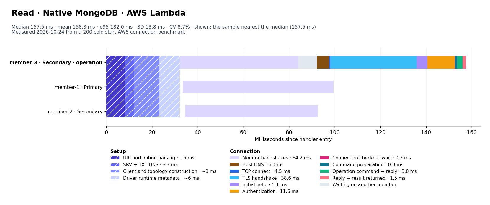
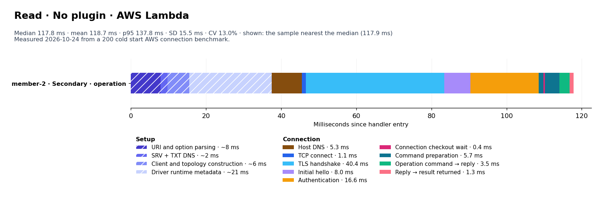
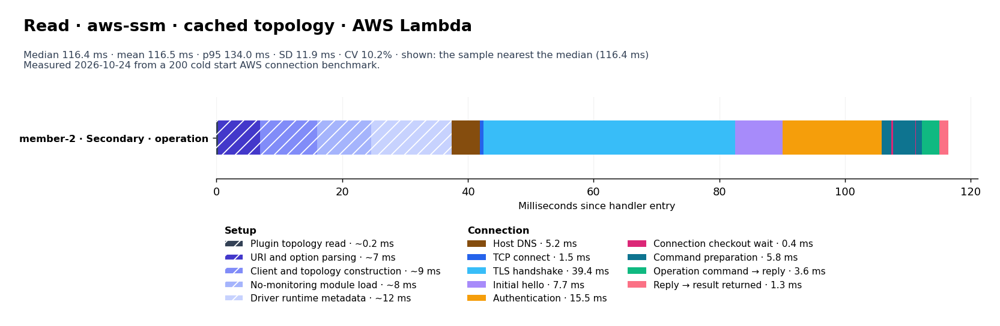
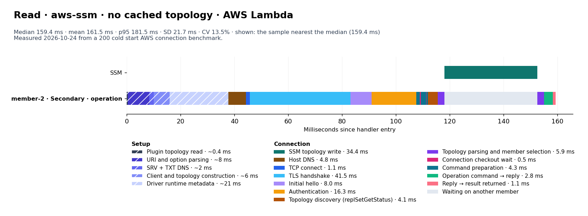
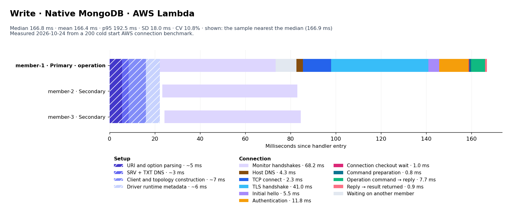
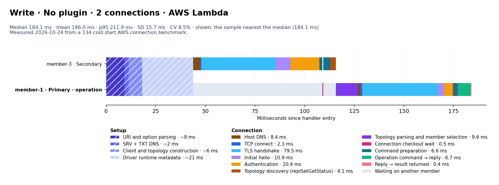
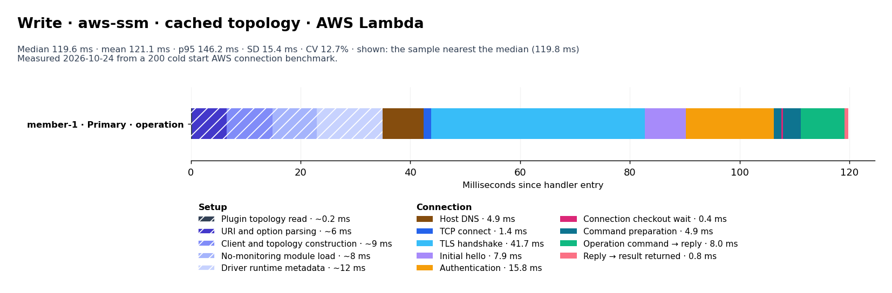
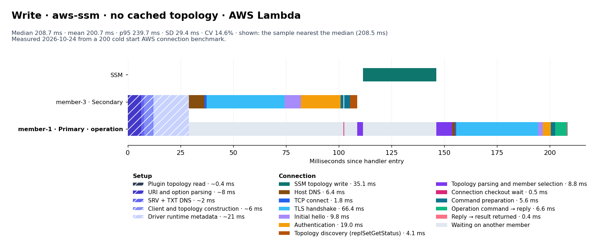

# AWS Lambda results

Measured 2026-10-24T17:06:28.821Z · Node v24.21.0.

| Operation / pattern | n | Mean | Median | SD | p95 | Mean 95% CI |
|---|---:|---:|---:|---:|---:|---:|
| read / Native MongoDB | 200 | 158.3 | 157.5 | 13.8 | 182.0 | 156.4–160.2 |
| read / No plugin | 200 | 118.7 | 117.8 | 15.5 | 137.8 | 116.8–121.0 |
| read / aws-ssm · cached topology | 200 | 116.5 | 116.4 | 11.9 | 134.0 | 114.9–118.2 |
| read / aws-ssm · no cached topology | 200 | 161.5 | 159.4 | 21.7 | 181.5 | 158.8–164.8 |
| write / Native MongoDB | 200 | 166.4 | 166.8 | 18.0 | 192.5 | 163.9–168.9 |
| write / No plugin | 200 | 165.0 | 172.4 | 33.4 | 208.7 | 160.5–169.6 |
| write / No plugin · 1 connection | 66 | 122.4 | 121.3 | 12.7 | 141.7 | 119.4–125.5 |
| write / No plugin · 2 connections | 134 | 186.0 | 184.1 | 15.7 | 211.9 | 183.3–188.7 |
| write / aws-ssm · cached topology | 200 | 121.1 | 119.6 | 15.4 | 146.2 | 119.1–123.3 |
| write / aws-ssm · no cached topology | 200 | 200.7 | 208.7 | 29.4 | 239.7 | 196.6–204.7 |

### Average read phase times

| Phase | Native MongoDB (n=200) | No plugin (n=200) | aws-ssm · cached topology (n=200) | aws-ssm · no cached topology (n=200) |
|---|---:|---:|---:|---:|
| Setup before the first member connection | 22.9 | 36.4 | 36.3 | 36.7 |
| ↳ Plugin topology read | — | — | ~0.2 | ~0.4 |
| ↳ URI and option parsing | ~6 | ~8 | ~7 | ~8 |
| ↳ SRV + TXT DNS | ~3 | ~2 | — | ~2 |
| ↳ Client and topology construction | ~8 | ~6 | ~9 | ~6 |
| ↳ No-monitoring module load | — | — | ~8 | — |
| ↳ Driver runtime metadata | ~6 | ~21 | ~12 | ~21 |
| SSM parameter request | 0.0 | 0.0 | 0.0 | 0.0 |
| SSM topology write | 0.0 | 0.0 | 0.0 | 34.4 |
| Monitor handshakes | 64.2 | 0.0 | 0.0 | 0.0 |
| Host DNS | 5.0 | 5.3 | 5.2 | 4.8 |
| TCP connect | 4.5 | 1.1 | 1.5 | 1.1 |
| TLS handshake | 38.6 | 40.4 | 39.4 | 41.5 |
| Initial hello | 5.1 | 8.0 | 7.7 | 8.0 |
| Authentication | 11.6 | 16.6 | 15.5 | 16.3 |
| Topology discovery (replSetGetStatus) | 0.0 | 0.0 | 0.0 | 4.1 |
| Topology parsing and member selection | 0.0 | 0.0 | 0.0 | 5.9 |
| Connection checkout wait | 0.2 | 0.4 | 0.4 | 0.5 |
| Command preparation | 0.9 | 5.7 | 5.8 | 4.3 |
| Operation command → reply | 3.8 | 3.5 | 3.6 | 2.8 |
| Reply → result returned | 1.5 | 1.3 | 1.3 | 1.1 |
| Other handler work | 0.0 | 0.0 | 0.0 | 0.0 |
| **Total** | **158.3** | **118.7** | **116.5** | **161.5** |

### Average write phase times

| Phase | Native MongoDB (n=200) | No plugin (n=200) | No plugin · 1 connection (n=66) | No plugin · 2 connections (n=134) | aws-ssm · cached topology (n=200) | aws-ssm · no cached topology (n=200) |
|---|---:|---:|---:|---:|---:|---:|
| Setup before the first member connection | 21.3 | 36.9 | 37.4 | 36.7 | 35.4 | 36.3 |
| ↳ Plugin topology read | — | — | — | — | ~0.2 | ~0.4 |
| ↳ URI and option parsing | ~5 | ~8 | ~8 | ~8 | ~6 | ~8 |
| ↳ SRV + TXT DNS | ~3 | ~2 | ~2 | ~2 | — | ~2 |
| ↳ Client and topology construction | ~7 | ~6 | ~6 | ~6 | ~9 | ~6 |
| ↳ No-monitoring module load | — | — | — | — | ~8 | — |
| ↳ Driver runtime metadata | ~6 | ~22 | ~22 | ~21 | ~12 | ~21 |
| SSM parameter request | 0.0 | 0.0 | 0.0 | 0.0 | 0.0 | 0.0 |
| SSM topology write | 0.0 | 0.0 | 0.0 | 0.0 | 0.0 | 35.1 |
| Monitor handshakes | 68.2 | 0.0 | 0.0 | 0.0 | 0.0 | 0.0 |
| Host DNS | 4.3 | 7.1 | 4.6 | 8.4 | 4.9 | 6.4 |
| TCP connect | 2.3 | 2.0 | 1.2 | 2.3 | 1.4 | 1.8 |
| TLS handshake | 41.0 | 66.8 | 40.9 | 79.5 | 41.7 | 66.4 |
| Initial hello | 5.5 | 10.0 | 8.1 | 10.9 | 7.9 | 9.8 |
| Authentication | 11.8 | 19.1 | 16.3 | 20.4 | 15.8 | 19.0 |
| Topology discovery (replSetGetStatus) | 0.0 | 2.7 | 0.0 | 4.1 | 0.0 | 4.1 |
| Topology parsing and member selection | 0.0 | 6.4 | 0.0 | 9.6 | 0.0 | 8.8 |
| Connection checkout wait | 1.0 | 0.5 | 0.4 | 0.5 | 0.4 | 0.5 |
| Command preparation | 0.8 | 6.1 | 5.1 | 6.6 | 4.9 | 5.6 |
| Operation command → reply | 7.7 | 7.0 | 7.6 | 6.7 | 8.0 | 6.6 |
| Reply → result returned | 0.9 | 0.6 | 0.8 | 0.4 | 0.8 | 0.4 |
| Other handler work | 1.5 | 0.0 | 0.0 | 0.0 | 0.0 | 0.0 |
| **Total** | **166.4** | **165.0** | **122.4** | **186.0** | **121.1** | **200.7** |

Durations are milliseconds from handler entry to the operation result. SSM retrieval during startup is excluded.

Every phase comes from driver events (`commandStarted`, `connectionReady`, `serverHeartbeat*`, `topologyOpening`, checkout events) and socket events (`lookup`, `connect`, `secureConnect`, first reply). Nothing in the driver is patched. Each millisecond is counted once, in the order the table lists phases; overlapping sockets are not added.

Setup has no events inside it. The ↳ rows marked ~ split the measured setup in proportions from an earlier run with code probes; SRV + TXT DNS applies only where the pattern resolves the SRV record.

Confidence intervals use 10,000 bootstrap resamples with a fixed seed and describe this run only.

8 warm checks verified client and socket reuse without another SSM request or discovery. They are excluded from the cold results.

### Read connection breakdowns

#### Native MongoDB

#### No plugin

#### aws-ssm · cached topology

#### aws-ssm · no cached topology

### Write connection breakdowns

#### Native MongoDB

#### No plugin · 1 connection

#### No plugin · 2 connections

#### aws-ssm · cached topology

#### aws-ssm · no cached topology

Each chart shows the sample nearest its cohort median. Sockets occupy separate overlapping rows; do not add their times.
