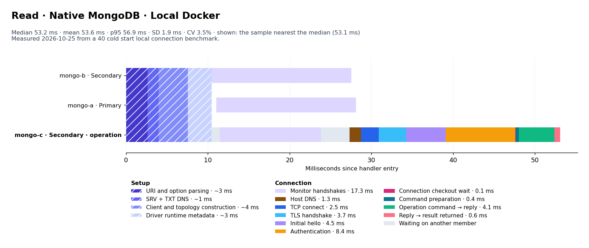
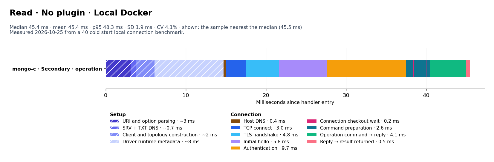
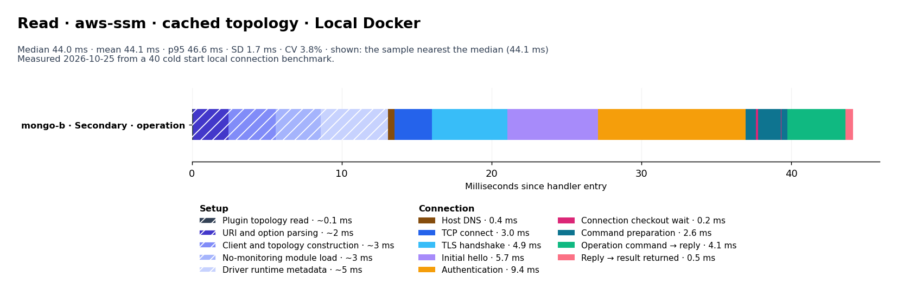
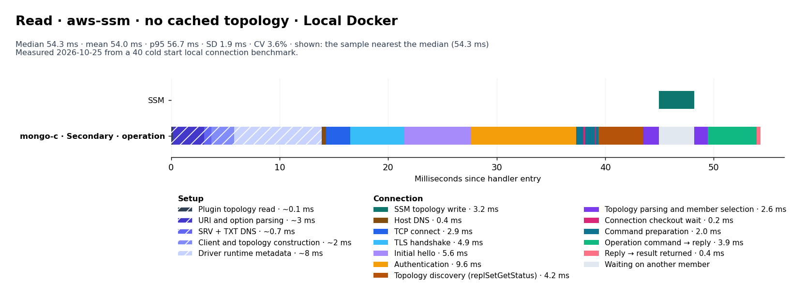
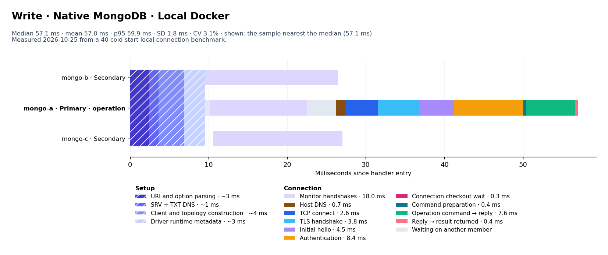
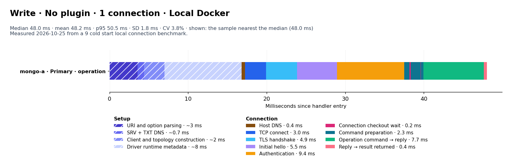
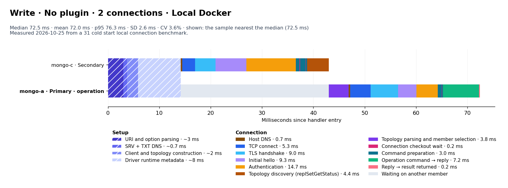
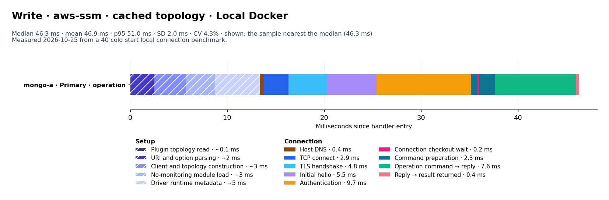
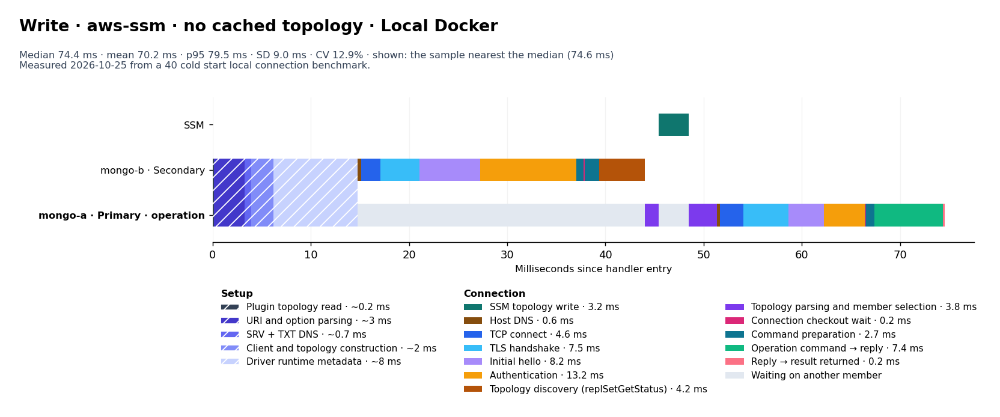

# Local Docker results

Measured 2026-10-25T15:49:02.633Z · Node v24.18.0.

| Operation / pattern | n | Mean | Median | SD | p95 | Mean 95% CI |
|---|---:|---:|---:|---:|---:|---:|
| read / Native MongoDB | 40 | 53.6 | 53.2 | 1.9 | 56.9 | 53.1–54.2 |
| read / No plugin | 40 | 45.4 | 45.4 | 1.9 | 48.3 | 44.9–46.0 |
| read / aws-ssm · cached topology | 40 | 44.1 | 44.0 | 1.7 | 46.6 | 43.6–44.6 |
| read / aws-ssm · no cached topology | 40 | 54.0 | 54.3 | 1.9 | 56.7 | 53.4–54.6 |
| write / Native MongoDB | 40 | 57.0 | 57.1 | 1.8 | 59.9 | 56.5–57.6 |
| write / No plugin | 40 | 66.7 | 71.3 | 10.4 | 75.6 | 63.3–69.7 |
| write / No plugin · 1 connection | 9 | 48.2 | 48.0 | 1.8 | 50.5 | 47.1–49.3 |
| write / No plugin · 2 connections | 31 | 72.0 | 72.5 | 2.6 | 76.3 | 71.1–72.9 |
| write / aws-ssm · cached topology | 40 | 46.9 | 46.3 | 2.0 | 51.0 | 46.3–47.5 |
| write / aws-ssm · no cached topology | 40 | 70.2 | 74.4 | 9.0 | 79.5 | 67.4–72.8 |

### Average read phase times

| Phase | Native MongoDB (n=40) | No plugin (n=40) | aws-ssm · cached topology (n=40) | aws-ssm · no cached topology (n=40) |
|---|---:|---:|---:|---:|
| Setup before the first member connection | 10.6 | 14.4 | 13.2 | 14.3 |
| ↳ Plugin topology read | — | — | ~0.1 | ~0.1 |
| ↳ URI and option parsing | ~3 | ~3 | ~2 | ~3 |
| ↳ SRV + TXT DNS | ~1 | ~0.7 | — | ~0.7 |
| ↳ Client and topology construction | ~4 | ~2 | ~3 | ~2 |
| ↳ No-monitoring module load | — | — | ~3 | — |
| ↳ Driver runtime metadata | ~3 | ~8 | ~5 | ~8 |
| SSM parameter request | 0.0 | 0.0 | 0.0 | 0.0 |
| SSM topology write | 0.0 | 0.0 | 0.0 | 3.2 |
| Monitor handshakes | 17.3 | 0.0 | 0.0 | 0.0 |
| Host DNS | 1.3 | 0.4 | 0.4 | 0.4 |
| TCP connect | 2.5 | 3.0 | 3.0 | 2.9 |
| TLS handshake | 3.7 | 4.8 | 4.9 | 4.9 |
| Initial hello | 4.5 | 5.8 | 5.7 | 5.6 |
| Authentication | 8.4 | 9.7 | 9.4 | 9.6 |
| Topology discovery (replSetGetStatus) | 0.0 | 0.0 | 0.0 | 4.2 |
| Topology parsing and member selection | 0.0 | 0.0 | 0.0 | 2.6 |
| Connection checkout wait | 0.1 | 0.2 | 0.2 | 0.2 |
| Command preparation | 0.4 | 2.6 | 2.6 | 2.0 |
| Operation command → reply | 4.1 | 4.1 | 4.1 | 3.9 |
| Reply → result returned | 0.6 | 0.5 | 0.5 | 0.4 |
| Other handler work | 0.0 | 0.0 | 0.0 | 0.0 |
| **Total** | **53.6** | **45.4** | **44.1** | **54.0** |

### Average write phase times

| Phase | Native MongoDB (n=40) | No plugin (n=40) | No plugin · 1 connection (n=9) | No plugin · 2 connections (n=31) | aws-ssm · cached topology (n=40) | aws-ssm · no cached topology (n=40) |
|---|---:|---:|---:|---:|---:|---:|
| Setup before the first member connection | 10.2 | 14.2 | 14.5 | 14.1 | 13.3 | 14.4 |
| ↳ Plugin topology read | — | — | — | — | ~0.1 | ~0.2 |
| ↳ URI and option parsing | ~3 | ~3 | ~3 | ~3 | ~2 | ~3 |
| ↳ SRV + TXT DNS | ~1 | ~0.7 | ~0.7 | ~0.7 | — | ~0.7 |
| ↳ Client and topology construction | ~4 | ~2 | ~2 | ~2 | ~3 | ~2 |
| ↳ No-monitoring module load | — | — | — | — | ~3 | — |
| ↳ Driver runtime metadata | ~3 | ~8 | ~8 | ~8 | ~5 | ~8 |
| SSM parameter request | 0.0 | 0.0 | 0.0 | 0.0 | 0.0 | 0.0 |
| SSM topology write | 0.0 | 0.0 | 0.0 | 0.0 | 0.0 | 3.2 |
| Monitor handshakes | 18.0 | 0.0 | 0.0 | 0.0 | 0.0 | 0.0 |
| Host DNS | 0.7 | 0.7 | 0.4 | 0.7 | 0.4 | 0.6 |
| TCP connect | 2.6 | 4.8 | 3.0 | 5.3 | 2.9 | 4.6 |
| TLS handshake | 3.8 | 8.1 | 4.9 | 9.0 | 4.8 | 7.5 |
| Initial hello | 4.5 | 8.5 | 5.5 | 9.3 | 5.5 | 8.2 |
| Authentication | 8.4 | 13.5 | 9.4 | 14.7 | 9.7 | 13.2 |
| Topology discovery (replSetGetStatus) | 0.0 | 3.4 | 0.0 | 4.4 | 0.0 | 4.2 |
| Topology parsing and member selection | 0.0 | 3.0 | 0.0 | 3.8 | 0.0 | 3.8 |
| Connection checkout wait | 0.3 | 0.2 | 0.2 | 0.2 | 0.2 | 0.2 |
| Command preparation | 0.4 | 2.8 | 2.3 | 3.0 | 2.3 | 2.7 |
| Operation command → reply | 7.6 | 7.3 | 7.7 | 7.2 | 7.6 | 7.4 |
| Reply → result returned | 0.4 | 0.2 | 0.4 | 0.2 | 0.4 | 0.2 |
| Other handler work | 0.2 | 0.0 | 0.0 | 0.0 | 0.0 | 0.0 |
| **Total** | **57.0** | **66.7** | **48.2** | **72.0** | **46.9** | **70.2** |

Durations are milliseconds from handler entry to the operation result. SSM retrieval during startup is excluded.

Every phase comes from driver events (`commandStarted`, `connectionReady`, `serverHeartbeat*`, `topologyOpening`, checkout events) and socket events (`lookup`, `connect`, `secureConnect`, first reply). Nothing in the driver is patched. Each millisecond is counted once, in the order the table lists phases; overlapping sockets are not added.

Setup has no events inside it. The ↳ rows marked ~ split the measured setup in proportions from an earlier run with code probes; SRV + TXT DNS applies only where the pattern resolves the SRV record.

Confidence intervals use 10,000 bootstrap resamples with a fixed seed and describe this run only.

8 warm checks verified client and socket reuse without another SSM request or discovery. They are excluded from the cold results.

### Read connection breakdowns

#### Native MongoDB

#### No plugin

#### aws-ssm · cached topology

#### aws-ssm · no cached topology

### Write connection breakdowns

#### Native MongoDB

#### No plugin · 1 connection

#### No plugin · 2 connections

#### aws-ssm · cached topology

#### aws-ssm · no cached topology

Each chart shows the sample nearest its cohort median. Sockets occupy separate overlapping rows; do not add their times.
