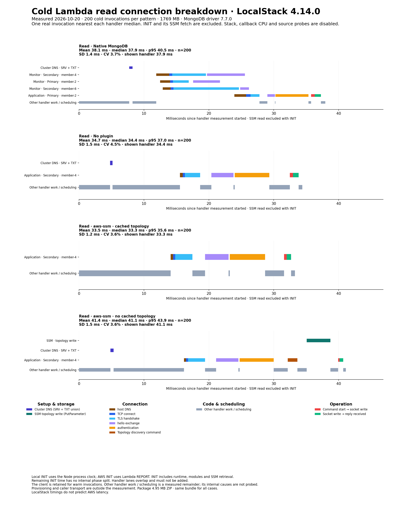
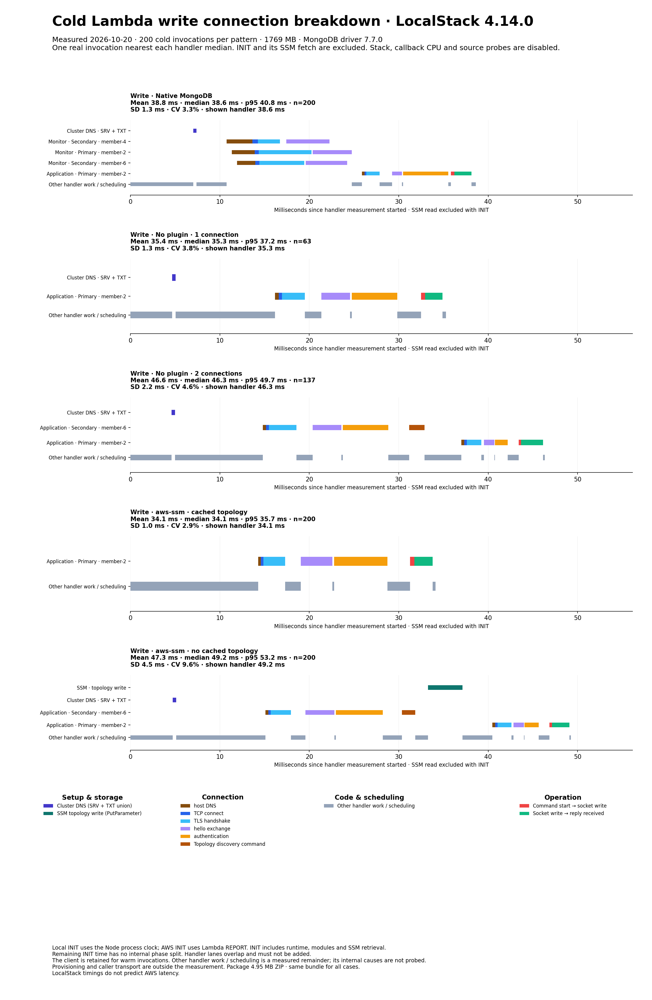

# LocalStack 4.14.0 results

Measured 2026-10-20T03:35:10.990Z · Node v24.21.0.

| Operation / pattern | n | Mean | Median | SD | p95 | Mean 95% CI |
|---|---:|---:|---:|---:|---:|---:|
| read / Native MongoDB | 200 | 38.1 | 37.9 | 1.4 | 40.5 | 37.9–38.3 |
| read / No plugin | 200 | 34.7 | 34.4 | 1.5 | 37.0 | 34.4–34.9 |
| read / aws-ssm · cached topology | 200 | 33.5 | 33.3 | 1.2 | 35.6 | 33.3–33.7 |
| read / aws-ssm · no cached topology | 200 | 41.4 | 41.1 | 1.5 | 43.9 | 41.2–41.6 |
| write / Native MongoDB | 200 | 38.8 | 38.6 | 1.3 | 40.8 | 38.7–39.0 |
| write / No plugin | 200 | 43.1 | 45.5 | 5.6 | 49.2 | 42.3–43.9 |
| write / aws-ssm · cached topology | 200 | 34.1 | 34.1 | 1.0 | 35.7 | 34.0–34.2 |
| write / aws-ssm · no cached topology | 200 | 47.3 | 49.2 | 4.5 | 53.2 | 46.7–48.0 |
| No plugin / lucky write, 1 connection | 63 | 35.4 | 35.3 | 1.3 | 37.2 | 35.1–35.8 |
| No plugin / write, 2 connections | 137 | 46.6 | 46.3 | 2.2 | 49.7 | 46.3–47.0 |

### Average read phase times

| Phase | Native MongoDB (n=200) | No plugin (n=200) | aws-ssm · cached topology (n=200) | aws-ssm · no cached topology (n=200) |
|---|---:|---:|---:|---:|
| Cluster DNS · SRV + TXT | 0.4 | 0.4 | 0.0 | 0.4 |
| Monitor handshakes · overlapping time counted once | 12.6 | 0.0 | 0.0 | 0.0 |
| Application host DNS | 1.4 | 0.4 | 0.4 | 0.4 |
| TCP connection | 0.5 | 0.3 | 0.3 | 0.3 |
| TLS handshake | 1.6 | 2.5 | 2.5 | 2.5 |
| Initial hello | 1.2 | 3.4 | 3.4 | 3.4 |
| Authentication | 5.5 | 5.3 | 5.3 | 5.3 |
| Topology discovery | 0.0 | 0.0 | 0.0 | 1.6 |
| Topology storage · SSM PutParameter | 0.0 | 0.0 | 0.0 | 3.9 |
| Additional hello commands | 0.0 | 0.0 | 0.0 | 0.0 |
| Prepare/send operation | 0.4 | 0.4 | 0.4 | 0.2 |
| Operation request → reply | 0.7 | 0.8 | 0.9 | 0.7 |
| Other handler work / scheduling | 13.7 | 21.0 | 20.2 | 22.7 |
| **Total** | **38.1** | **34.7** | **33.5** | **41.4** |

### Average write phase times

| Phase | Native MongoDB (n=200) | No plugin (n=200) | No plugin · lucky (n=63) | No plugin · 2 connections (n=137) | aws-ssm · cached topology (n=200) | aws-ssm · no cached topology (n=200) |
|---|---:|---:|---:|---:|---:|---:|
| Cluster DNS · SRV + TXT | 0.4 | 0.4 | 0.4 | 0.4 | 0.0 | 0.4 |
| Monitor handshakes · overlapping time counted once | 13.3 | 0.0 | 0.0 | 0.0 | 0.0 | 0.0 |
| Application host DNS | 1.0 | 0.6 | 0.4 | 0.7 | 0.5 | 0.6 |
| TCP connection | 0.3 | 0.5 | 0.3 | 0.6 | 0.3 | 0.5 |
| TLS handshake | 1.6 | 3.6 | 2.5 | 4.2 | 2.5 | 3.5 |
| Initial hello | 1.2 | 4.2 | 3.4 | 4.5 | 3.4 | 4.1 |
| Authentication | 5.5 | 6.3 | 5.3 | 6.8 | 5.2 | 6.2 |
| Topology discovery | 0.0 | 1.1 | 0.0 | 1.6 | 0.0 | 1.6 |
| Topology storage · SSM PutParameter | 0.0 | 0.0 | 0.0 | 0.0 | 0.0 | 3.8 |
| Additional hello commands | 0.0 | 0.0 | 0.0 | 0.0 | 0.0 | 0.0 |
| Prepare/send operation | 0.4 | 0.3 | 0.5 | 0.2 | 0.5 | 0.2 |
| Operation request → reply | 2.1 | 2.0 | 2.3 | 1.9 | 2.2 | 1.9 |
| Other handler work / scheduling | 13.1 | 24.0 | 20.4 | 25.6 | 19.5 | 24.5 |
| **Total** | **38.8** | **43.1** | **35.4** | **46.6** | **34.1** | **47.3** |

All durations are milliseconds from handler measurement entry through the operation result. Lambda INIT, including the completed SSM fetch, is excluded. The client is created lazily and retained for warm calls. Raw INIT and SSM measurements remain in samples.json.

Phase averages cover every invocation and add to the average handler total before rounding. Overlapping sockets are counted once. Without detailed probes, other handler work and scheduling is an elapsed remainder; its CPU, callback and internal code breakdown is not measured.

Mean confidence intervals use 10,000 percentile bootstrap resamples with a fixed seed, assuming independent observations within this run. SD is the sample standard deviation. These intervals do not measure variation between deployments or days. Write landing cohorts occur naturally and have unequal counts.

Package: 4,951,360 bytes ZIP; identical for every case. Detailed execution/source probes: disabled. DNS/socket/command timers remain enabled.

8 separate warm checks verified environment and client reuse without another SSM request, cluster DNS or topology discovery. These checks are excluded from the cold distributions.

### Read connection breakdown

### Write connection breakdown

Each panel shows a real invocation nearest the handler median. Connections occupy separate overlapping lanes; do not add their elapsed times. INIT, provisioning, caller transport and post-result reporting are outside the overview. LocalStack timings do not predict AWS performance.
