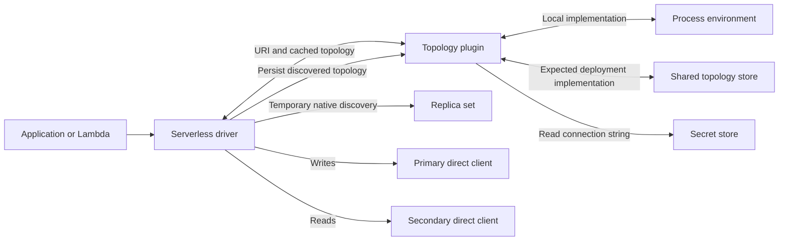
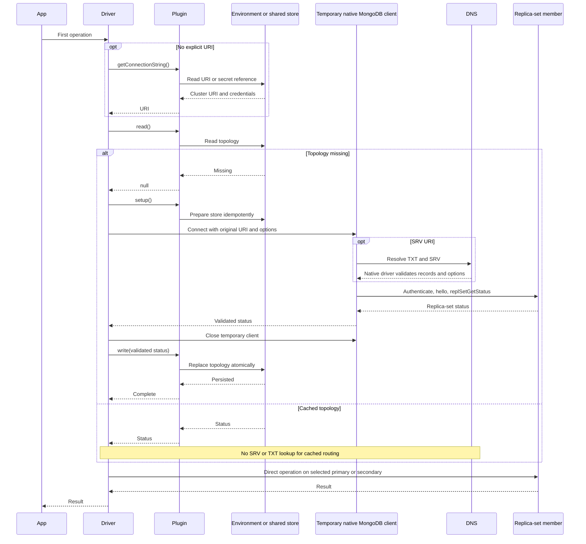
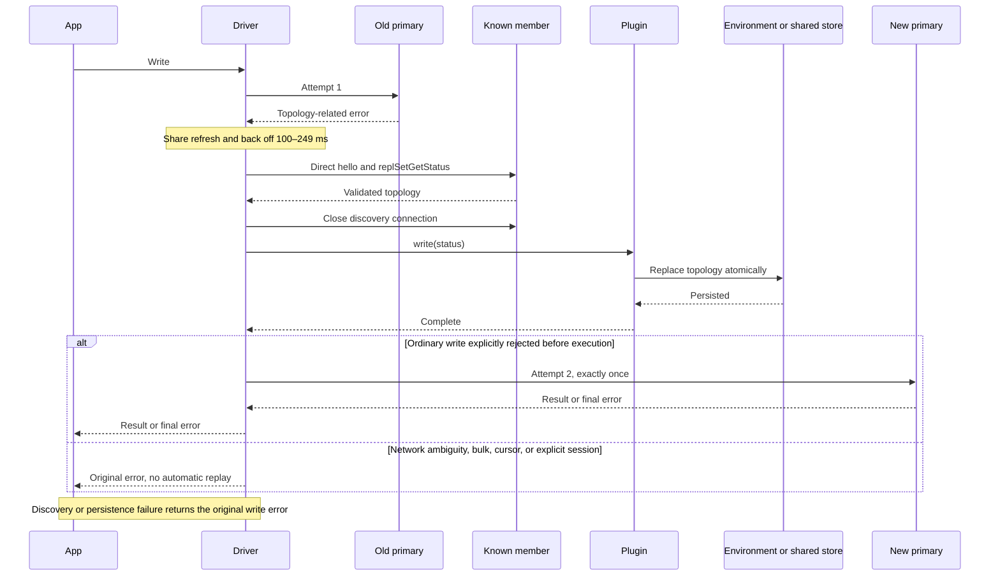
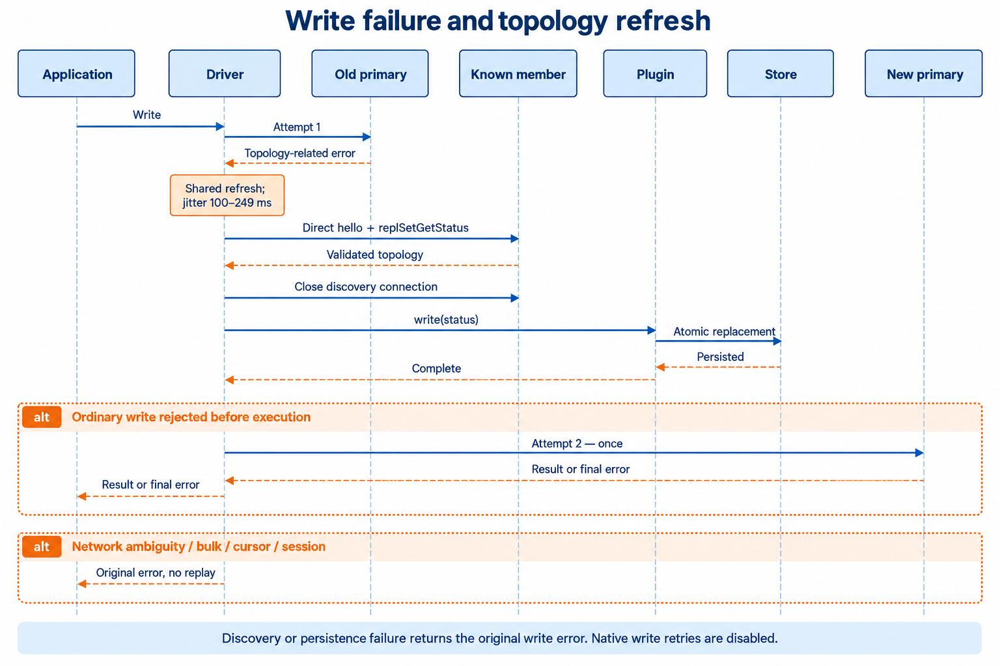

# Driver discovery and plugin contract

The driver owns discovery and exception-driven refresh. A plugin supplies a
connection string and persists topology. The local implementation stores topology
in `process.env`; a deployment plugin should use a durable shared store. There is
no AWS plugin in this change.

## Architecture

Each wrapper owns lazy direct read and write clients. Initial discovery uses a
temporary native MongoDB client with the original URI and constructor options.
The native driver handles DNS, authentication, and replica-set discovery; the
temporary client closes after reading status. There is no polling service.
Native SDAM monitoring on routed clients remains on unless
`disableMonitoring: true` is selected.

The facade receives a router for selecting read and write clients and a separate
write executor for handling failures and deciding whether to retry. The client
pair owns topology state and coalesces refresh requests across operations. Each
retry selects its client again using the refreshed topology.

## First use and cached routing

`getConnectionString()` is optional for plugins used with an explicit URI. It
returns the cluster URI, credentials, and URI options from the plugin's existing
configuration or secret store. The driver never copies credentials into topology.
An explicit constructor URI takes precedence. Secret rotation requires a new
wrapper instance; the connection string is resolved once for each wrapper.

`read()` returns `null` only when no topology exists. Authentication, permission,
transport, and malformed-data failures must throw. On a miss, `setup()` must be
idempotent and prepare the topology store if needed. The driver then discovers
and validates status before awaiting `write(status)` and routing the operation.
`verify()` remains an explicit diagnostic operation, not a per-request hook.

Routed clients and refresh through cached members use the original connection
settings without SRV or TXT lookups. Supply `authSource` explicitly when
authentication depends on a TXT default: DNS options used by the temporary
discovery client are not carried into routed connections.

## Write failure and refresh

Only topology-related write failures trigger recovery. Duplicate-key, validation,
and authorization errors return directly. Calls in the same wrapper that fail
against the same topology generation share one refresh. Different Lambda
instances can discover concurrently; this contract provides no distributed lock.

A refresh waits 100–249 ms, tries cached members once each, validates the resulting
status, and awaits persistence before switching routes. The default selection
timeout is five seconds for initial discovery and five seconds per cached member
during refresh. An explicit `serverSelectionTimeoutMS` overrides that timeout.

Native write retries are disabled underneath the wrapper to keep the total at
two attempts. Ordinary promise-returning operations can replay only for a
`MongoServerError` with code 10107 or 13435, or a `NoWritesPerformed` label.
Bulk builders and cursors never replay automatically, because earlier batches,
results, or writes may already exist. Read failures do not trigger refresh.
An election that outlasts this recovery attempt remains a caller-visible error.

## Expected plugin implementations

| Concern | Local plugin | Expected deployment plugin |
|---|---|---|
| URI and credentials | Environment variable | Secret store or deployment configuration |
| Topology read | Parse environment JSON; missing means `null` | Read a cluster-specific item; missing means `null` |
| Setup | No operation | Idempotent provisioning, or validate pre-provisioned storage |
| Topology write | Replace environment JSON | Atomically replace the cluster-specific document |
| Permissions | Process environment access | Secret read, topology read/write, and any setup permissions |
| Persistence | Current process only | Shared across cold starts and instances |

A store must not expose a partially written document. Plugin authors should
consider conditional writes using replica-set election metadata to avoid older
discoveries overwriting newer ones. The current contract does not provide
compare-and-swap or return an accepted topology from `write()`: coherence across
concurrent writers is best effort, and a later failure can trigger another refresh.
Keep credentials out of topology records and logs; the secret store remains the
authoritative source. Configure a separate key for each cluster.

Plugins are validated structurally. `setup`, `verify`, `read`, and `write` must be
functions; `name`, `version`, and `author` must be strings. Extending
`ServerlessPlugin` is optional. A subclass used for discovery must enable writes
in its constructor. Shared contract source compiles into each package and is not
published as a separate dependency.

## Migration and review notes

- Remove the watcher deployment and its polling configuration. The watcher package
  and `refreshIntervalMS` are removed from this workspace.
- Give the application identity permission to run `hello` and `replSetGetStatus`,
  and to write topology through its plugin. Existing read-only deployments need
  permission changes before adopting discovery.
- Update plugins to return `null` for a missing topology. Existing plugins that
  return a populated status and use an explicit URI remain structurally compatible.
- Use a shared topology store for Lambda. Updating `process.env` does not persist
  across cold starts.
- Replica sets only: no sharded or load-balanced clusters, change streams, or
  sessions spanning clients. Refresh updates future routing; existing cursors and
  bulk builders remain bound to the client that created them.
- Existing direct clients remain open until wrapper `close()`, including members
  no longer selected after refresh. This avoids interrupting in-flight operations.
