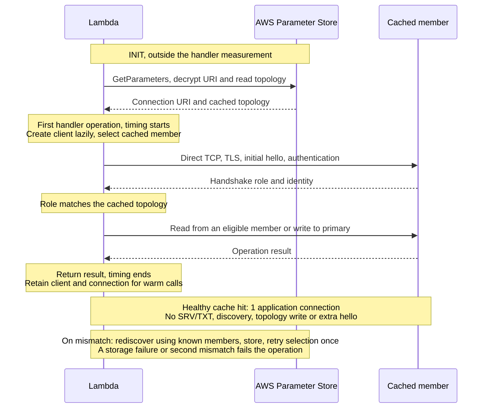
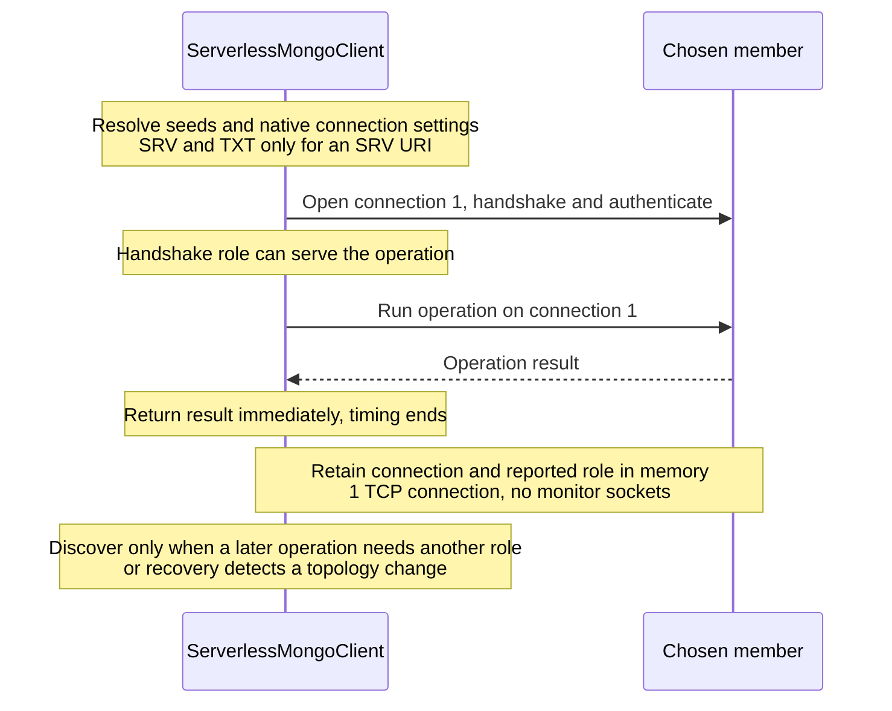
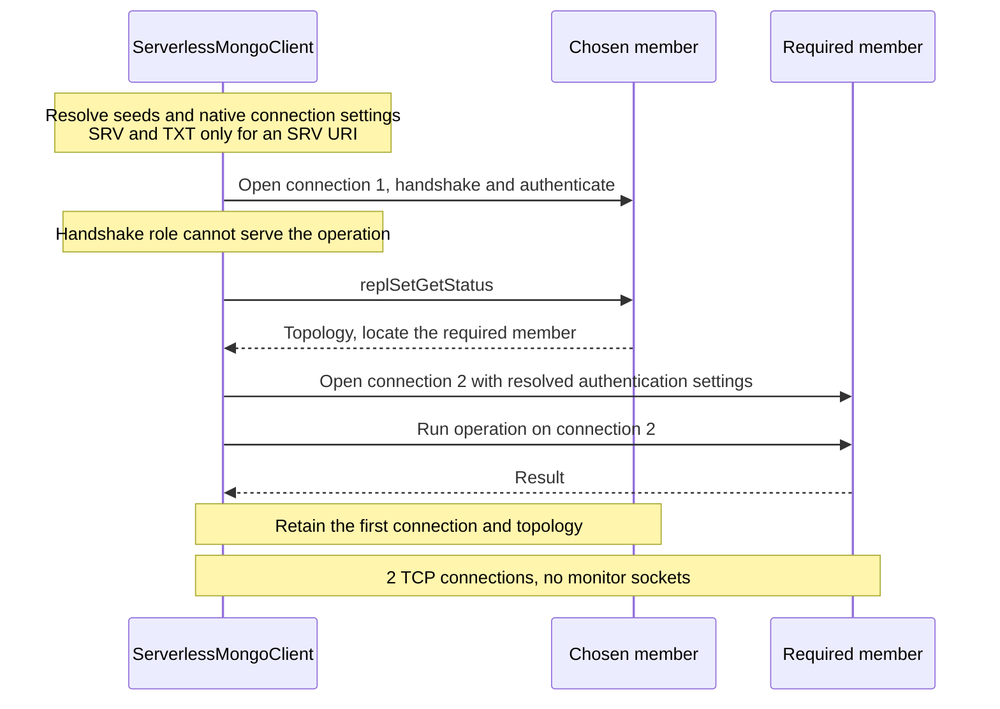

# Driver discovery and plugin contract

The driver discovers replica-set topology itself and refreshes it after role
mismatches or topology-related write failures. Topology stays in memory for each
client. A plugin optionally supplies the connection string and shares topology
across clients: the local plugin uses `process.env`, and the
[SSM plugin](../plugins/aws-ssm) shares it across Lambda instances, fetched with
the SecureString connection string in one request.

## Connections

Each client owns direct connections to the members its operations need. On first
use without cached topology, the native driver's parser and SRV/TXT resolver
produce the seed list and connection settings. The client tries seeds in random
order and connects directly to one. If that member's handshake role can serve the
operation, the operation runs on it straight away. Otherwise the client reads
`replSetGetStatus` through the same connection and opens one more to the member
it needs. Later operations reuse both.

Writes go to the primary. Reads prefer a connected healthy secondary, then the
first healthy secondary, then the primary. An operation-level `nearest` read
reuses any connected healthy member.

Before using a member, the client checks the role the native driver last reported
for it against the topology. A mismatch triggers one refresh, which persists the
corrected topology, and selection runs again; a second mismatch fails before the
operation is sent. With monitoring disabled, reused connections are not polled,
so an election can still happen between the check and the operation.

### With stored topology

A matching cached topology skips seed resolution and discovery: the client opens
one direct connection to the member it needs. The benchmark deployment fetches
the URI and topology during Lambda INIT and creates the client on first use.



### Without a plugin: the first member can serve



### Without a plugin: another member is needed



### Connection counts

The one- and two-connection counts above need monitoring disabled from the first
connection and one socket per member:

```js
import { MongoClient } from '@mongodb-serverless/driver';

const client = new MongoClient(uri, {
  disableMonitoring: true,
  maxPoolSize: 1,
  minPoolSize: 0
});

try {
  await client.db('app').collection('users').insertOne({ name: 'Ada' });
} finally {
  await client.close();
}
```

Monitoring stays enabled by default. The monitoring patch supports SCRAM,
unauthenticated connections and TLS; other authentication mechanisms use normal
monitoring. `directConnection` alone does not remove monitor sockets. Concurrent
operations, failed seeds, idle-socket replacement and elections can open more.
SRV resolution and the patch use driver internals verified against
`mongodb@7.7.0`; stable versions in `>=7.7.0 <8.0.0` are accepted.

## Plugin contract

`read()` returns `null` only when no topology exists. Authentication, permission,
transport and malformed-data failures must throw. On a miss the driver calls
`setup()`, which must be idempotent, then discovers, validates the status, and
awaits `write(status)` before routing. `verify()` is a diagnostic the driver never
calls itself.

`getConnectionString()` is optional. A plugin that implements it can create a
client with `MongoClient.fromPlugin(plugin)`; the connection string is fetched
once, on first use, so rotating it needs a new client. An explicit URI takes
precedence, and the driver never copies credentials into topology.

The driver adds `authentication: { mechanism, source }` to the status when the
native client has credentials, and plugins must preserve it. Direct connections
use that source unless the caller supplies `authSource`, and take passwords,
certificates and provider callbacks from the client's own configuration. A
different authentication mechanism triggers discovery again, so keep separate
records for different authentication defaults.

| Concern | Local plugin | Expected deployment plugin |
|---|---|---|
| URI and credentials | Environment variable | Secret store or deployment configuration |
| Topology read | Parse environment JSON; missing means `null` | Read a cluster-specific item; missing means `null` |
| Setup | No operation | Idempotent provisioning, or validate pre-provisioned storage |
| Topology write | Replace environment JSON | Atomically replace the cluster-specific document |
| Permissions | Process environment access | Secret read, topology read/write, and any setup permissions |
| Persistence | Current process only | Shared across cold starts and instances |

A store must not expose a partially written document. The contract has no
compare-and-swap, so concurrent writers are last-write-wins and a later failure
can trigger another refresh. Plugins are validated structurally: `setup`,
`verify`, `read` and `write` must be functions, and `name`, `version` and
`author` strings. Extending `ServerlessPlugin` is optional; its subclasses are
writable unless constructed with `{ writable: false }`.

## Write failure and refresh

Only topology-related write failures trigger recovery; duplicate-key,
validation and authorization errors return directly. Calls in one client that
fail against the same topology share one refresh, which starts at once, tries
the known members, validates the status, and persists it before routing changes.
Separate Lambda instances can discover concurrently; there is no distributed
lock. Discovery and refresh wait up to five seconds per seed unless
`serverSelectionTimeoutMS` says otherwise.


Direct clients keep the native `retryWrites` setting, on by default. The native
retry goes back to the same member, so it recovers a dropped connection but not
a primary change; after a failover the driver's own replay reaches the new
primary, for up to three attempts. The driver replays an ordinary
promise-returning operation only for a `MongoServerError` with code 10107 or
13435, or a `NoWritesPerformed` label. Bulk builders, cursors and explicit
sessions never replay, because earlier batches, results or writes may already
exist. Read failures do not trigger refresh, and an election that outlasts
recovery reaches the caller.

Refresh updates future routing only. Existing cursors and bulk builders stay on
the client that created them, and direct clients stay open until `close()`, so
in-flight operations are not interrupted.
