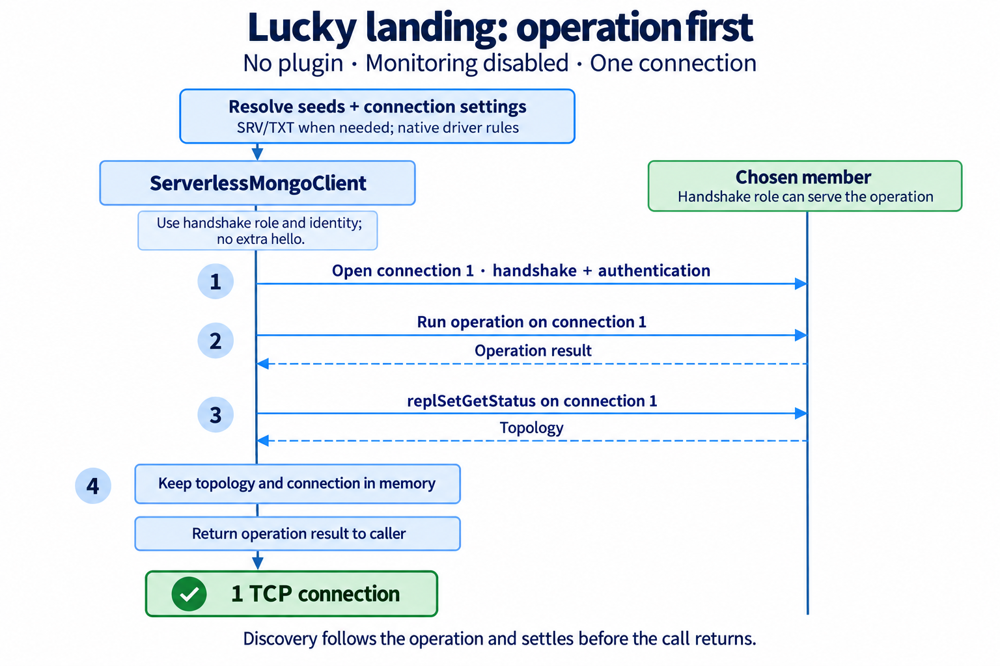
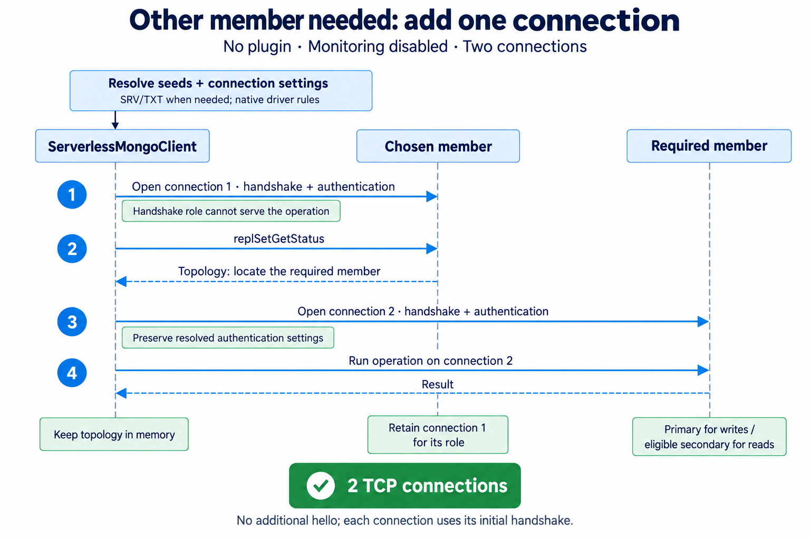

# Connections with and without stored topology

A client can discover and route operations without a plugin. It keeps topology
and connections in memory until `close()`. A plugin optionally shares topology
with later client instances.

## With stored topology

A new client reads the plugin's topology, selects the cached member, and opens a
direct connection. The native handshake supplies the member's current role.
Matching roles allow the operation to proceed without status discovery or an
extra `hello` command.

On a mismatch, the client reruns discovery through known members, awaits
`plugin.write(status)`, and selects a member from the corrected topology. A
second mismatch fails the operation. Concurrent mismatches share one refresh
within the wrapper. A storage failure also fails the operation. A later client
reads the corrected topology from the plugin.

The check uses native server-description events. With monitoring disabled,
reusing a connection does not request a new role check over the network. An
election can occur between validation and execution. This change does not
implement the remaining read-preference features.

## Without a plugin

These diagrams show `disableMonitoring: true`, `maxPoolSize: 1`, and
`minPoolSize: 0` on a healthy replica set. They count TCP connections opened for
bootstrap and sequential operations. Concurrent work, failed seeds, idle socket
replacement, and elections can require more connections.

### Lucky landing: operation first

A write reuses a primary landing. An explicit operation-level `nearest` read
reuses either healthy member role. Other reads keep the secondary-first policy
and can use the primary when no healthy secondary exists. The initial handshake
supplies the role and identity. A suitable operation runs first; discovery then
uses the same socket. The call waits for discovery to settle before returning,
so a Lambda does not freeze unfinished work. There is no additional `hello`.
Discovery does not open another connection even when the pool permits more.



<details>
<summary>Editable Mermaid</summary>

```mermaid
sequenceDiagram
    participant Driver as ServerlessMongoClient
    participant Seed as Chosen member
    Note over Driver: Resolve seeds and native connection settings<br/>SRV and TXT only for an SRV URI
    Driver->>Seed: Open connection 1; handshake and authenticate
    Note over Driver: Handshake role can serve the operation
    Driver->>Seed: Run operation on connection 1
    Seed-->>Driver: Operation result
    Driver->>Seed: replSetGetStatus on connection 1
    Seed-->>Driver: Topology
    Note over Driver: Return operation result after discovery settles
    Note over Driver,Seed: Retain topology and connection in memory<br/>1 TCP connection; no monitor sockets
```

</details>

### Other member needed: add one connection

The initial handshake reports a role that cannot serve the operation. Discovery
must finish before choosing another member.
The client opens one connection to the required member and retains the first
connection for operations that can use it. Unrestricted `nearest` reads reuse
an eligible connected member; other reads prefer a connected healthy secondary.



<details>
<summary>Editable Mermaid</summary>

```mermaid
sequenceDiagram
    participant Driver as ServerlessMongoClient
    participant Seed as Chosen member
    participant Target as Required member
    Note over Driver: Resolve seeds and native connection settings<br/>SRV and TXT only for an SRV URI
    Driver->>Seed: Open connection 1; handshake and authenticate
    Note over Driver: Handshake role cannot serve the operation
    Driver->>Seed: replSetGetStatus
    Seed-->>Driver: Topology; locate the required member
    Driver->>Target: Open connection 2 with resolved authentication settings
    Driver->>Target: Run operation on connection 2
    Target-->>Driver: Result
    Note over Driver,Seed: Retain the first connection and topology
    Note over Driver,Target: 2 TCP connections; no monitor sockets
```

</details>

## Configuration

```js
import { MongoClient } from '@mongodb-serverless/driver';

const client = new MongoClient(uri, {
  disableMonitoring: true,
  maxPoolSize: 1,
  minPoolSize: 0
});

try {
  await client.db('app').collection('users').insertOne({ name: 'Ada' });
} finally {
  await client.close();
}
```

Monitoring remains enabled by default. The experimental monitoring patch
supports SCRAM, unauthenticated connections, and TLS. Other authentication
mechanisms use normal monitoring. The one/two-socket count requires monitoring
to be disabled from bootstrap onward; `directConnection` alone does not remove
monitor sockets. Larger pools can open more sockets for concurrent operations.

The native driver's parser and SRV/TXT resolver retain authentication precedence,
TLS defaults, replica-set settings, and DNS host validation. Native clients still
perform handshake and authentication. SRV resolution and the monitoring patch
use internal APIs verified against `mongodb@7.7.0`; stable versions in
`>=7.7.0 <8.0.0` are accepted, with behavior rechecked on upgrades.

Failed seeds are closed before trying another. Plugin cache misses still discover
and persist before operations; a failed topology-store write closes that
connection and fails the operation. Without a plugin, discovery after an
executed operation cannot change its result. A failed discovery is retried on
the next call; routing to another member requires successful discovery. A successful bootstrap
connection is owned by the wrapper and closes with it. No credentials are
persisted in topology; optional shared records contain only the authentication
mechanism and resolved source alongside replica-set status.

A matching cached topology skips seed resolution and status discovery. Direct
connections open only for members needed by operations; a role mismatch refreshes
topology before the application operation. Without a plugin, each new
client discovers for itself. Write-error recovery continues to use known members;
see [recovery and plugin behavior](architecture.md#write-failure-and-refresh).

## Verification

Run `pnpm exec vitest run driver/test/bootstrap driver/test/roles driver/test/seeds.test.ts`.
The bootstrap suites use real MongoDB servers, command events, and TCP relays
that count actual sockets. Only DNS records are stubbed for SRV tests.

| Case | Assertion |
|---|---|
| Cached role mismatch | Refresh and persist before the read; the next cold start uses the corrected record |
| Primary landing, first write | Insert precedes discovery; both share one socket, including with the default pool size |
| Secondary landing, first read | Find precedes discovery on the same socket, even when another secondary is listed first |
| Wrong role, first read or write | Two sockets; correct member serves the operation |
| Later reads and writes | Reuse the retained primary and secondary |
| Concurrent first writes | One discovery and one socket with a pool limit of one |
| SRV, TXT, SCRAM and TLS | One authenticated socket; resolved source survives into operations |
| Explicit TLS opt-out | Bootstrap and a new wrapper using cached topology both preserve it |
| Discovery failure after an operation | Preserve its result; retry discovery on the next call |
| Closed client | Reject before opening a bootstrap connection |
| Failed handshake | Close the failed client, then try another seed |
| Failed persistence or concurrent close | Close the discovered socket; do not execute the application operation |
| Invalid DNS or URI options | Reject before opening a connection |

The [authentication matrix](authentication-tests.md) separately verifies all
native mechanisms, cached clients, explicit-option precedence, and refresh.
